<p align="center">
  
</p>

# PolyForge

Proyecto de una web de aprendizaje de modelado 3D, texturizado e iluminación, con frontend en Angular y API en Spring Boot. Incluye registro de usuarios y una comunidad para compartir publicaciones de texto.

El catálogo contiene tres cursos introductorios con nueve lecciones y prácticas. El progreso se calcula a partir de las lecciones completadas y se guarda en la cuenta.

## Funcionalidades

- Registro e inicio de sesión con correo y contraseña.
- Cursos con lecciones, prácticas y progreso persistente por usuario.
- Categoría de aprendizaje preferida configurable desde Mi perfil.
- Comunidad con creación de publicaciones, búsqueda por título y descripción, likes y filtro de guardadas. Requiere iniciar sesión.
- Perfil con publicaciones propias, cierre de sesión y eliminación de cuenta. Al borrar la cuenta también se eliminan sus publicaciones y datos asociados.
- Temas claro y oscuro con la preferencia guardada en el navegador.
- Diseño adaptable, menú móvil, ayuda HelpNDoc y página 404.
- Validación de formularios, avisos de estado y navegación con teclado.

## Tecnologías

| Parte | Tecnologías |
| --- | --- |
| Frontend | Angular 21.2, TypeScript 5.9, RxJS y SCSS |
| Backend | Java 21, Spring Boot 3.5, Spring Security y Maven |
| Persistencia | Spring Data JPA, Hibernate y MySQL/MariaDB |
| Recursos | Tipografía del sistema e imágenes WebP locales en `public/` |

## Instalación y ejecución

### Requisitos

- Node.js `^20.19.0`, `^22.12.0` o `>=24.0.0`, según las dependencias del archivo de bloqueo.
- npm; `package.json` declara `npm@11.19.0`.
- JDK 21 y Maven, instalado o integrado en IntelliJ IDEA.
- MySQL o MariaDB en ejecución. Puedes usar el servicio MySQL de XAMPP.

### 1. Backend

La configuración por defecto conecta con `localhost:3306`, usuario `root` y contraseña vacía. Crea la base de datos `polyforge` si el usuario tiene permisos; Hibernate crea o actualiza las tablas.

Puedes ajustar la conexión mediante variables de entorno:

| Variable | Valor por defecto | Uso |
| --- | --- | --- |
| `DB_URL` | `jdbc:mysql://localhost:3306/polyforge?createDatabaseIfNotExist=true` | URL JDBC de la base de datos |
| `DB_USER` | `root` | Usuario de la base de datos |
| `DB_PASSWORD` | Vacía | Contraseña de la base de datos |
| `DB_SCHEMA` | `update` | Modo de gestión del esquema de Hibernate |
| `ANGULAR_ORIGIN` | `http://localhost:4200` | Origen del frontend permitido por CORS |

Desde la raíz del proyecto, con Maven disponible:

```bash
cd backend
mvn spring-boot:run
```

También puedes abrir `backend/pom.xml` en IntelliJ IDEA, seleccionar JDK 21 y ejecutar [PolyForge.java](backend/src/main/java/es/polyforge/PolyForge.java).

La API se sirve en `http://localhost:8080/api`.

### 2. Frontend

En otra terminal, desde la raíz del proyecto:

```bash
npm ci
npm start
```

Abre [http://localhost:4200](http://localhost:4200). El frontend llama a la API en el puerto `8080` del mismo servidor indicado en la URL del navegador. Para probar el registro, el perfil y la comunidad, mantén el backend y la base de datos en marcha.

## Uso

1. Entra en **Acceder → Regístrate** y crea una cuenta. La contraseña debe tener al menos ocho caracteres.
2. Inicia sesión con tu correo y contraseña.
3. En **Comunidad**, crea una publicación con título y descripción. Puedes buscar publicaciones, darles **Me gusta** y guardarlas.
4. En **Mi perfil**, edita tu correo con la contraseña actual, gestiona tus publicaciones o cierra sesión.

| Ruta | Contenido |
| --- | --- |
| `/inicio` | Cursos y progreso de muestra |
| `/login` | Inicio de sesión |
| `/registro` | Creación de cuenta |
| `/cursos` | Catálogo filtrado por la categoría preferida |
| `/cursos/:id` | Lecciones, prácticas y progreso de cada curso |
| `/comunidad` | Publicaciones y guardadas |
| `/perfil` | Cuenta y publicaciones propias |
| `/ayuda` | Manual HelpNDoc con contenido, índice y búsqueda |
| Otras rutas | Página 404 |

La sesión se mantiene mediante una cookie. Las contraseñas se almacenan como hashes BCrypt y las peticiones que modifican datos incluyen un token CSRF obtenido de `/api/csrf`.

La página de Ayuda explica el acceso, las publicaciones, los filtros y la gestión del perfil.

## AED — Modelo de datos y acceso a datos

PolyForge utiliza cuatro entidades JPA y dos tablas intermedias para gestionar las cuentas, las publicaciones, el soporte y las marcas de cada usuario. Esta sección reúne el diseño, sus transformaciones y la implementación del ORM. Los manuales con capturas se encuentran al final de la sección.

### Modelo entidad–relación

[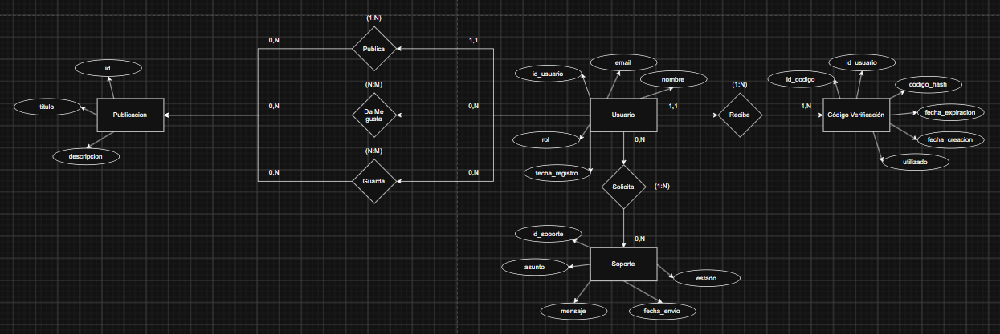](docs/imagenes/aed-entidad-relacion.png)

El diseño parte de Usuario, Publicación, Soporte y Código de verificación. Un usuario puede publicar varios contenidos y enviar varias consultas. Cada publicación y consulta pertenece a un único usuario. Los códigos se asocian también a una cuenta. Dar Me gusta y guardar son relaciones muchos a muchos entre usuarios y publicaciones.

La captura recoge una fase anterior del diseño. Incluye `nombre`, `rol` y `fecha_registro` en Usuario, y `estado` en Soporte. Las entidades Java actuales utilizan los campos definidos en las tablas de este apartado. La relación con códigos admite que una cuenta tenga cero códigos guardados, dado que el acceso actual funciona con contraseña.

### Transformación a UML

[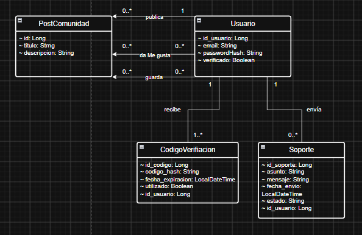](docs/imagenes/aed-uml.png)

Las entidades del modelo E/R se transforman en las clases `Usuario`, `PostComunidad`, `Soporte` y `CodigoVerificacion`. Los atributos pasan a propiedades Java y las relaciones se representan mediante referencias a `Usuario` o colecciones `Set<Usuario>`. En cada publicación, `autor` identifica al usuario y `likes` y `guardados` contienen los usuarios asociados.

En la implementación, las fechas de soporte y de caducidad se representan con `Instant`. La captura UML utiliza `LocalDateTime` y conserva `estado` y `fecha_envio` para Soporte. El código actual utiliza `creado` y los campos indicados en el diccionario de datos. `CodigoVerificacion` conserva además `intentos` y `usado`.

### Transformación al modelo relacional

[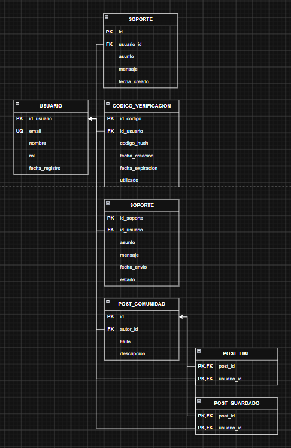](docs/imagenes/aed-relacional.png)

Cada entidad se transforma en una tabla con clave primaria autogenerada. Las relaciones uno a muchos añaden la clave foránea al lado de las publicaciones, consultas o códigos. Las relaciones muchos a muchos generan `post_like` y `post_guardado`, cada una con las claves de publicación y usuario.

La captura contiene dos bloques llamados `SOPORTE` y algunos nombres de atributos del diseño anterior. Hibernate utiliza una única tabla `soporte`. El esquema correspondiente a las entidades actuales es el siguiente. `PK` identifica la clave primaria, `FK` una clave foránea y `UQ` una restricción de unicidad.

```text
usuario
  id PK, email UQ, verificado, password_hash, categoria_preferida

post_comunidad
  id PK, autor_id FK → usuario.id, titulo, descripcion

soporte
  id PK, usuario_id FK → usuario.id, asunto, mensaje, creado

codigo_verificacion
  id PK, usuario_id FK → usuario.id, hash, expira, intentos, usado

post_like
  post_id PK/FK → post_comunidad.id
  usuario_id PK/FK → usuario.id

post_guardado
  post_id PK/FK → post_comunidad.id
  usuario_id PK/FK → usuario.id

usuario_leccion
  usuario_id PK/FK → usuario.id
  leccion PK
```

Las capturas corresponden al diseño previo a la entrega final. El aprendizaje añade categoria_preferida a usuario y la colección usuario_leccion. Los cursos y sus textos se definen en Angular; el backend valida los nueve identificadores de lección y conserva el avance de cada cuenta.

### Diccionario de datos y mapeo ORM

El ORM relaciona los objetos Java con las tablas de la base de datos. `@Entity` identifica las entidades y `@Table` fija sus nombres. Sus identificadores son `Long`, marcados con `@Id` y generados mediante `GenerationType.IDENTITY`.

#### Usuario

Tabla `usuario`, mapeada por `Usuario`.

| Campo Java | Tipo | Restricción y significado |
| --- | --- | --- |
| `id` | `Long` | Clave primaria autogenerada |
| `email` | `String` | Obligatorio, único y hasta 254 caracteres |
| `verificado` | `boolean` | Obligatorio. Estado de verificación conservado en el modelo |
| `passwordHash` | `String` | Hasta 60 caracteres. Hash BCrypt de la contraseña |
| `categoriaPreferida` | `String` | Hasta 16 caracteres. Categoría inicial del catálogo; Todas al recuperar cuentas anteriores |
| `leccionesCompletadas` | `Set<String>` | Identificadores guardados en la colección usuario_leccion |

El registro actual crea el hash de contraseña y la cuenta permite autenticarse con correo y contraseña. `verificado` se mantiene en el modelo y se devuelve en el perfil. El acceso actual no exige que su valor sea verdadero.

#### Publicación

Tabla `post_comunidad`, mapeada por `PostComunidad`.

| Campo Java | Tipo | Restricción y significado |
| --- | --- | --- |
| `id` | `Long` | Clave primaria autogenerada |
| `autor` | `Usuario` | Relación obligatoria con la cuenta autora mediante `autor_id` |
| `titulo` | `String` | Obligatorio y hasta 120 caracteres |
| `descripcion` | `String` | Obligatoria y hasta 4.000 caracteres |
| `likes` | `Set<Usuario>` | Usuarios que han marcado Me gusta |
| `guardados` | `Set<Usuario>` | Usuarios que han guardado la publicación |

#### Soporte

Tabla `soporte`, mapeada por `Soporte`.

| Campo Java | Tipo | Restricción y significado |
| --- | --- | --- |
| `id` | `Long` | Clave primaria autogenerada |
| `usuario` | `Usuario` | Relación obligatoria mediante `usuario_id` |
| `asunto` | `String` | Obligatorio y hasta 120 caracteres |
| `mensaje` | `String` | Obligatorio y hasta 4.000 caracteres |
| `creado` | `Instant` | Fecha obligatoria asignada por el servidor al crear la consulta |

El backend ofrece el CRUD de soporte. La pantalla Ayuda de la web actual presenta preguntas frecuentes.

#### Código de verificación

Tabla `codigo_verificacion`, mapeada por `CodigoVerificacion`.

| Campo Java | Tipo | Restricción y significado |
| --- | --- | --- |
| `id` | `Long` | Clave primaria autogenerada |
| `usuario` | `Usuario` | Relación obligatoria mediante `usuario_id` |
| `hash` | `String` | Valor obligatorio para el hash del código |
| `expira` | `Instant` | Fecha de caducidad obligatoria |
| `intentos` | `int` | Número de intentos |
| `usado` | `boolean` | Estado de utilización |

Esta entidad y su repositorio proceden del acceso anterior por código. El controlador actual autentica mediante contraseña. Al eliminar una cuenta también retira sus posibles códigos almacenados.

#### Relaciones y tablas intermedias

| Relación | Mapeo | Clave o tabla asociada |
| --- | --- | --- |
| Un usuario puede escribir varias publicaciones | `PostComunidad.autor` con `@ManyToOne` y carga `LAZY` | `post_comunidad.autor_id` referencia `usuario.id` |
| Un usuario puede tener varias consultas de soporte | `Soporte.usuario` con `@ManyToOne` y carga `LAZY` | `soporte.usuario_id` referencia `usuario.id` |
| Un usuario puede tener varios códigos | `CodigoVerificacion.usuario` con `@ManyToOne` y carga `LAZY` | `codigo_verificacion.usuario_id` referencia `usuario.id` |
| Varios usuarios pueden dar Me gusta a varias publicaciones | `PostComunidad.likes` con `@ManyToMany` | `post_like`, con `post_id` y `usuario_id` |
| Varios usuarios pueden guardar varias publicaciones | `PostComunidad.guardados` con `@ManyToMany` | `post_guardado`, con `post_id` y `usuario_id` |

Las tablas intermedias almacenan las parejas publicación–usuario. Cada pareja es única dentro de su colección de likes o guardados. `@JoinTable` y `@JoinColumn` definen las tablas y las claves foráneas de esas relaciones.

El progreso utiliza `@ElementCollection` y `@CollectionTable`. Cada par usuario–lección identifica una práctica completada. Las actualizaciones de progreso y preferencias bloquean la fila del usuario para conservar los cambios cuando coinciden dos peticiones.

Los repositorios extienden `JpaRepository`, que proporciona operaciones como `save`, `findById` y `delete`. El listado de publicaciones utiliza `findAllByOrderByIdDesc`. Las consultas de soporte se filtran por el usuario de la sesión. Las modificaciones de publicaciones y la limpieza de relaciones al borrar una cuenta utilizan consultas con bloqueo pesimista de escritura.

El controlador utiliza `@Transactional` para agrupar las operaciones de cada petición. Hibernate detecta los cambios de las entidades gestionadas al completar la transacción. Las respuestas utilizan los registros `PostVista` y `ConsultaVista` para enviar los datos que necesita la interfaz.

### Casos de uso

[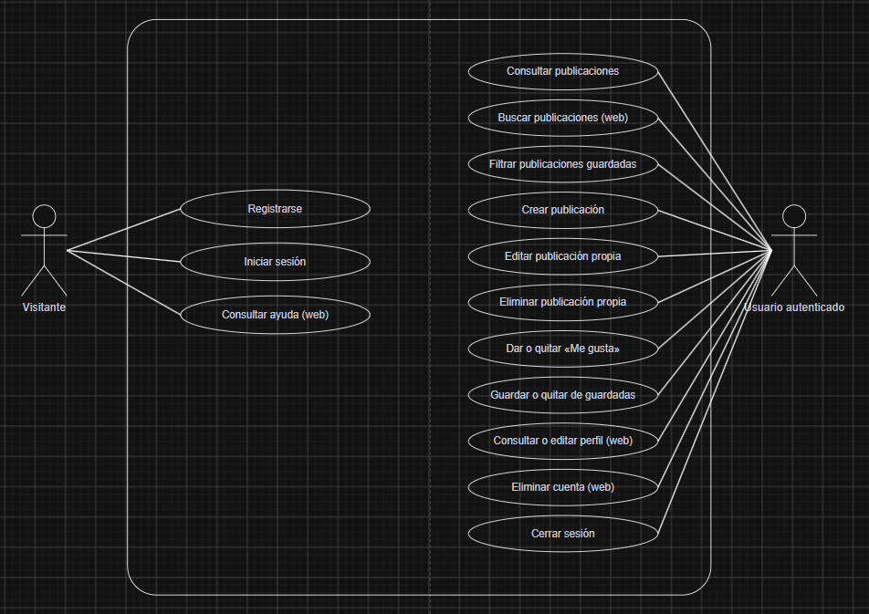](docs/imagenes/aed-casos-uso.png)

El visitante puede registrarse, iniciar sesión y consultar Ayuda. El usuario autenticado puede gestionar sus publicaciones y su perfil, guardar contenido, marcar Me gusta y cerrar sesión. La búsqueda por texto y las opciones marcadas como web corresponden al frontend Angular. El siguiente cuadro describe la intervención del backend en esas acciones y el CRUD de soporte disponible por API.

| Acción del usuario | Intervención del backend |
| --- | --- |
| Registrarse e iniciar sesión | Valida los datos, crea el hash BCrypt y establece la sesión al autenticar |
| Consultar y cambiar su correo | Recupera la cuenta de la sesión y verifica la contraseña actual antes del cambio |
| Publicar y consultar proyectos | Guarda título y descripción y devuelve las publicaciones ordenadas de más reciente a más antigua |
| Editar o borrar una publicación | Comprueba que pertenezca al usuario de la sesión y aplica la operación |
| Dar Me gusta o guardar contenido | Actualiza la relación entre usuario y publicación y devuelve las marcas actualizadas |
| Gestionar consultas de soporte por API | Permite crear, consultar, editar y borrar las consultas del usuario |
| Cerrar sesión | Invalida la sesión del servidor |
| Eliminar su cuenta | Retira los datos asociados, elimina la cuenta y cierra la sesión |

La búsqueda por texto y el filtro Todas/Guardadas se realizan en Angular sobre el listado recibido. El backend conserva las publicaciones y las marcas que utiliza ese filtro.

### Organización del backend

| Archivo | Responsabilidad |
| --- | --- |
| [PolyForge.java](backend/src/main/java/es/polyforge/PolyForge.java) | Arranque de Spring Boot |
| [Api.java](backend/src/main/java/es/polyforge/Api.java) | Endpoints, validaciones, sesión y operaciones de cada usuario |
| [Security.java](backend/src/main/java/es/polyforge/Security.java) | CORS, CSRF y codificación de contraseñas |
| [Repositories.java](backend/src/main/java/es/polyforge/Repositories.java) | Repositorios JPA y consultas |
| [Usuario.java](backend/src/main/java/es/polyforge/Usuario.java) | Cuenta del usuario |
| [PostComunidad.java](backend/src/main/java/es/polyforge/PostComunidad.java) | Publicación, autor, likes y guardados |
| [Soporte.java](backend/src/main/java/es/polyforge/Soporte.java) | Consulta de soporte de un usuario |
| [CodigoVerificacion.java](backend/src/main/java/es/polyforge/CodigoVerificacion.java) | Modelo conservado del acceso anterior por código |

### API

Todas las rutas de la tabla parten de `/api`. Las rutas de perfil, publicaciones y soporte comprueban el usuario de la sesión.

| Método | Ruta | Operación |
| --- | --- | --- |
| GET | `/csrf` | Obtener el nombre de cabecera y el token CSRF |
| POST | `/registro` | Crear cuenta con `email` y `password` |
| POST | `/sesion` | Iniciar sesión con `email` y `password` |
| DELETE | `/sesion` | Cerrar la sesión |
| GET | `/usuarios/me` | Consultar el perfil actual |
| PUT | `/usuarios/me` | Cambiar el correo con `email` y la contraseña actual en `password` |
| DELETE | `/usuarios/me` | Eliminar la cuenta y sus datos asociados |
| GET | `/aprendizaje` | Recuperar las lecciones completadas y la categoría preferida |
| PUT | `/aprendizaje/{leccion}` | Marcar o desmarcar una lección con el booleano completada |
| PUT | `/preferencias` | Guardar categoria, con Todas, Modelado, Texturizado o Render |
| GET | `/posts` | Listar publicaciones y marcas del usuario |
| POST | `/posts` | Crear publicación con `titulo` y `descripcion` |
| PUT | `/posts/{id}` | Editar una publicación propia |
| DELETE | `/posts/{id}` | Eliminar una publicación propia |
| PUT | `/posts/{id}/like` | Activar o quitar Me gusta con `activo` |
| PUT | `/posts/{id}/guardado` | Guardar o desguardar con `activo` |
| GET | `/soporte` | Listar las consultas propias |
| GET | `/soporte/{id}` | Leer una consulta propia |
| POST | `/soporte` | Crear consulta con `asunto` y `mensaje` |
| PUT | `/soporte/{id}` | Editar una consulta propia |
| DELETE | `/soporte/{id}` | Eliminar una consulta propia |

#### Sesión, seguridad y validaciones

La sesión guarda el identificador del usuario en el servidor. El navegador conserva su cookie, configurada con `HttpOnly` y `SameSite=Lax`, y la envía mediante `credentials: 'include'`. Tras autenticar, se cambia el identificador de sesión.

Antes de una petición de escritura, el cliente consulta `GET /api/csrf`, conserva la cookie y envía el token en la cabecera indicada por `headerName`. Spring Security comprueba ese token. Las contraseñas se guardan con BCrypt y se comprueban mediante `matches`.

El correo se valida, se recorta y se convierte a minúsculas. Las contraseñas requieren al menos ocho caracteres y admiten hasta 72 bytes UTF-8. Los títulos, descripciones, asuntos y mensajes deben contener texto y respetar sus límites. Para likes y guardados, `activo` debe ser un booleano presente en el cuerpo JSON.

| Estado HTTP | Significado en la API |
| --- | --- |
| `200` | Lectura o modificación que devuelve datos |
| `201` | Cuenta, publicación o consulta creada |
| `204` | Operación completada sin cuerpo de respuesta |
| `400` | Datos que incumplen las validaciones |
| `401` | Credenciales incorrectas o sesión ausente o caducada |
| `403` | Petición rechazada por CSRF o contraseña actual incorrecta al cambiar el perfil |
| `404` | Recurso inexistente o publicación/consulta ajena al intentar modificarla o acceder a una consulta |
| `409` | Correo ya registrado |

Al borrar una cuenta, se eliminan sus consultas, códigos y publicaciones. También se retiran sus likes y guardados de publicaciones ajenas. Finalmente, se elimina el usuario y se invalida la sesión.

### Comprobaciones de acceso a datos

Se verificó el arranque con Java 21, Maven y MariaDB, el registro, el acceso y el CRUD de publicaciones. También se comprobaron likes y guardados. Estas pruebas utilizaron una base temporal con datos de ejemplo, que se retiró al finalizar. El proyecto todavía carece de una batería de pruebas automatizadas del backend.

### Manuales de instalación y usuario

Los dos manuales PDF se entregan por separado en el campus. Las instrucciones y capturas siguientes permiten instalar y utilizar el proyecto desde el repositorio.

#### Comprobar la instalación

Después de iniciar MySQL, Spring Boot y Angular, abre `http://localhost:4200`. Crea una cuenta desde **Acceder → Regístrate**, inicia sesión y publica en Comunidad. Recarga el listado para comprobar la persistencia. Las capturas de los manuales se obtuvieron con datos de ejemplo en una base temporal de MariaDB.

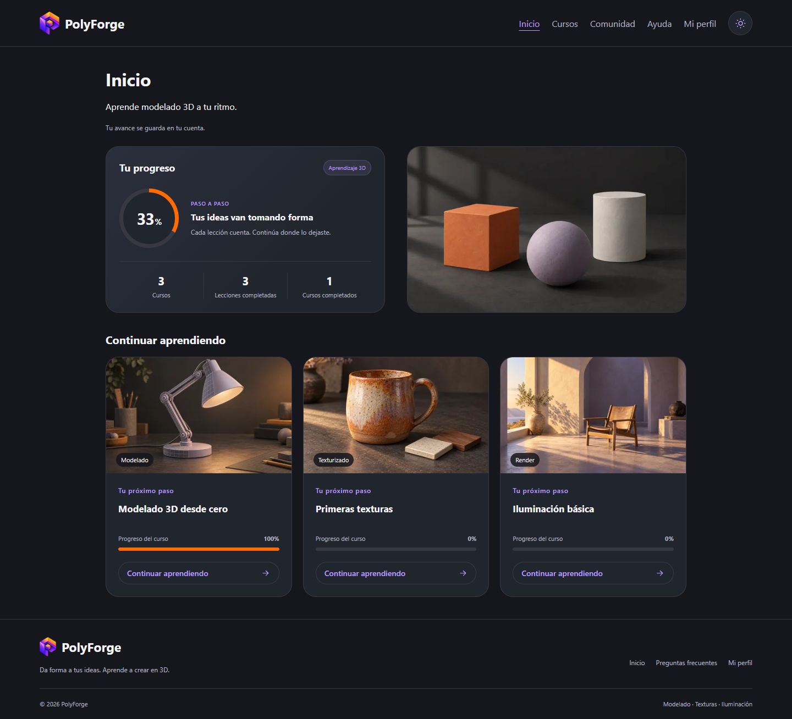

Si utilizas MariaDB de XAMPP, puedes seleccionar su controlador mediante esta variable de entorno en PowerShell antes de ejecutar el backend.

```powershell
$env:DB_URL='jdbc:mariadb://localhost:3306/polyforge?createDatabaseIfNotExist=true'
```

Si falla la base de datos, revisa MySQL y las variables de conexión. Si la web abre pero la API falla, revisa que el backend siga en el puerto 8080 y que el navegador use `localhost:4200`, el origen permitido por defecto. Para terminar, pulsa `Ctrl+C` en las terminales de Angular y Spring Boot y detén MySQL desde XAMPP.

#### Registro y acceso

El registro pide correo, contraseña de al menos ocho caracteres y confirmación. Pulsa **Registrarme** y, después de la confirmación, inicia sesión. Los errores de credenciales o de correo duplicado se muestran junto al formulario. La sesión se conserva mediante una cookie.

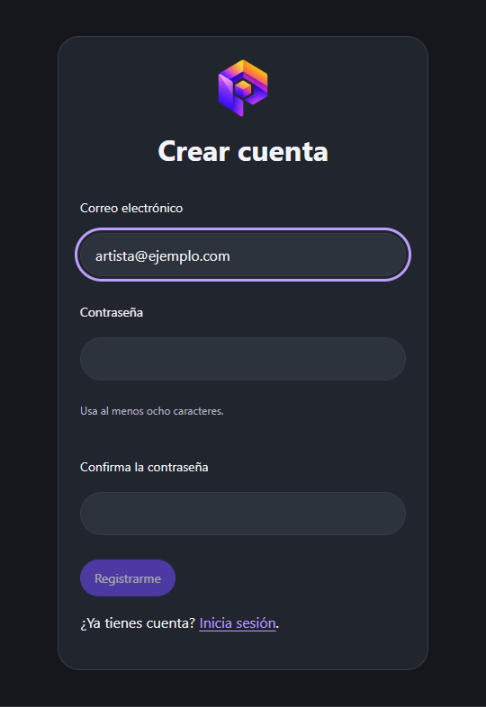
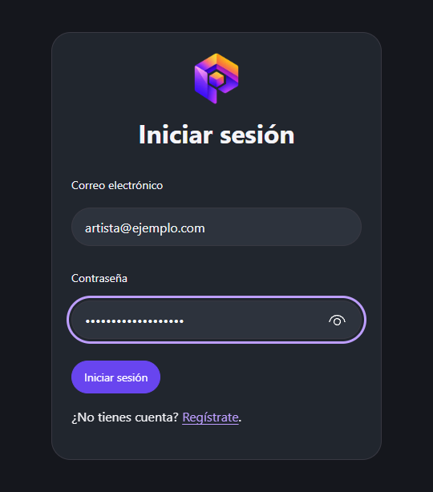

#### Publicaciones

En Comunidad, pulsa **Nueva publicación**. El título admite hasta 120 caracteres y la descripción hasta 4.000. Ambos campos son obligatorios. **Publicar** guarda el contenido y **Cancelar** cierra el editor.

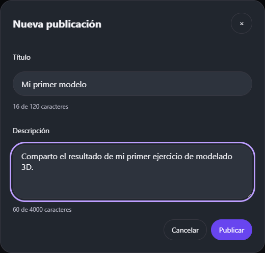

El lápiz abre la edición de una publicación propia. **Guardar cambios** aplica la modificación. La papelera abre una confirmación antes de borrar y **Cancelar** conserva el contenido. El corazón activa o quita un Me gusta y el marcador guarda o desguarda la publicación. **Actualizar** vuelve a pedir el listado.

#### Búsqueda, filtros y recuperación

Escribe parte del título o de la descripción en **Buscar publicaciones**, hasta 120 caracteres. El filtro **Guardadas** muestra tus publicaciones guardadas y **Todas** vuelve al conjunto completo. El contador indica el filtro, el texto y el número de coincidencias. La **×** limpia el texto conservando el filtro. Cambiar el filtro conserva la búsqueda.

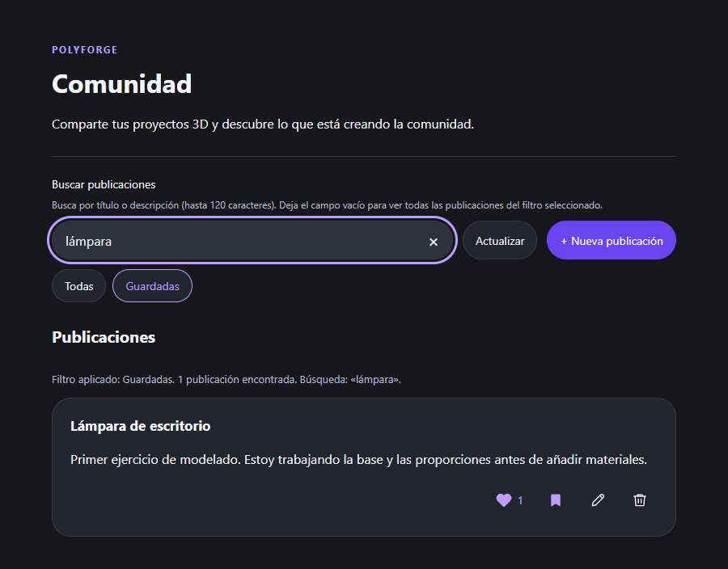

Si no hay coincidencias, cambia el texto o limpia el campo. Si falla la carga inicial, revisa la conexión y pulsa **Reintentar**. Si la sesión caduca, vuelve a Acceder.

#### Perfil, navegación y ayuda

En **Mi perfil**, puedes ver tus publicaciones, cambiar el correo con la contraseña actual, guardar la categoría preferida y cerrar sesión. **Eliminar cuenta** pide confirmación y elimina la cuenta y sus datos asociados. La cabecera enlaza las pantallas y el menú móvil muestra las mismas opciones.

El botón del sol o la luna cambia el tema y guarda la preferencia en el navegador. Puedes usar `Tab`, `Enter` y **Saltar al contenido** para navegar con teclado. Ayuda explica estas funciones y los pasos para recuperar una operación fallida. Cursos ofrece nueve lecciones con prácticas. Marcar una lección actualiza el progreso de Inicio y lo guarda en la cuenta. Las operaciones de Comunidad y el guardado de progreso requieren conexión.

## DAD — Entrega final

### Cursos, progreso y personalización

En Cursos, cada tarjeta abre tres lecciones con una práctica. El usuario puede marcar una lección como completada o pendiente. El radial de Inicio representa la proporción de lecciones completadas y las estadísticas indican el catálogo, las lecciones finalizadas y los cursos completados.

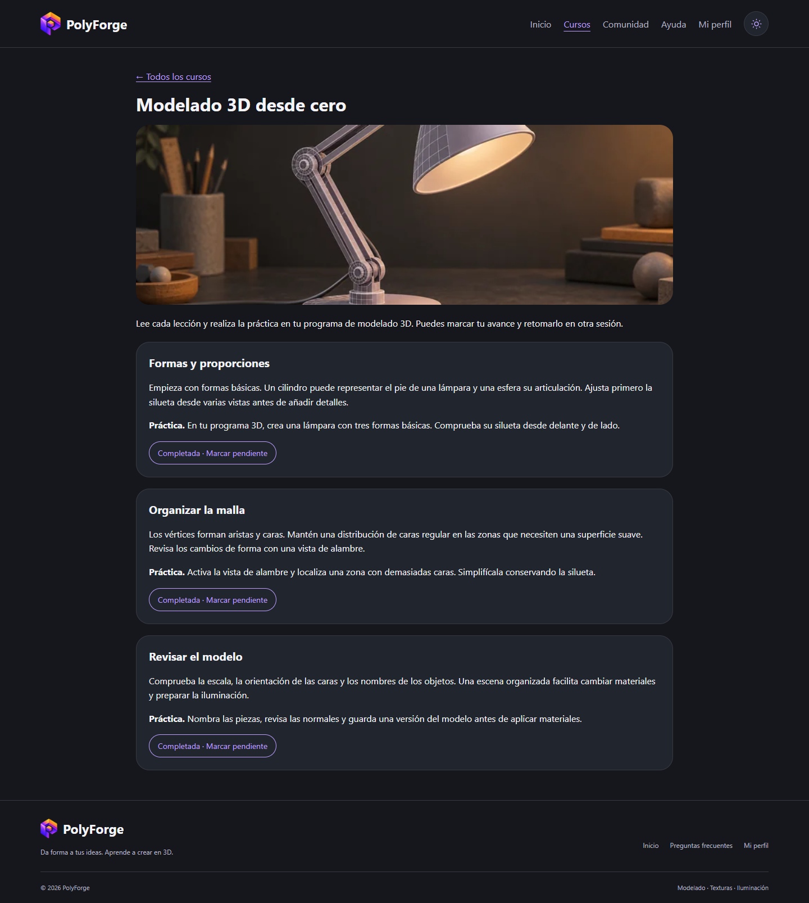

En Mi perfil, elige la categoría preferida y pulsa Guardar preferencia. Se conserva en la base de datos y se utiliza como filtro inicial de Cursos. Cada cuenta recupera sus propias preferencias y su avance.

### Ayuda HelpNDoc

La ruta Ayuda integra una exportación real de HelpNDoc Personal con seis páginas, índice de palabras, búsqueda e imágenes. El manual también puede abrirse en página completa. El proyecto editable está en [PolyForge.hnd](docs/ayuda/PolyForge.hnd).

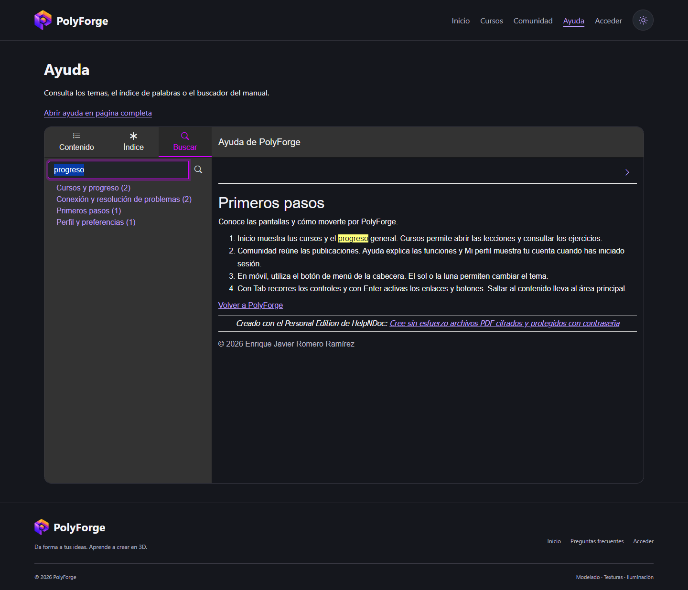

Para regenerar la salida HTML, abre el proyecto en HelpNDoc o ejecuta el siguiente comando desde la raíz en PowerShell. El parámetro HelpNDoc permite indicar otra ruta de instalación.

```powershell
./scripts/generar-ayuda.ps1
```

El script prepara la plantilla morada y la traducción, y genera public/ayuda-web. La edición Personal conserva el aviso de licencia de HelpNDoc. Las pantallas y recursos visitados se guardan bajo demanda para su consulta offline.

### Compilación y vista previa PWA

Ejecuta npm run build. Para probar HTTPS, necesitas el certificado local y su clave en tmp/https/localhost.pem y tmp/https/localhost-key.pem, o indicar sus rutas mediante POLYFORGE_TLS_CERT y POLYFORGE_TLS_KEY. El navegador debe confiar en el certificado utilizado.

Arranca el backend con el origen de la vista previa permitido. En PowerShell, desde la carpeta backend, configura ANGULAR_ORIGIN antes de ejecutarlo.

```powershell
$env:ANGULAR_ORIGIN='https://localhost:8443'
mvn spring-boot:run
```

Desde otra terminal en la raíz, ejecuta npm run preview:pwa. La dirección http://localhost:8081 redirige mediante 308 a https://localhost:8443. La vista previa comprime los recursos de texto con gzip o Brotli según lo que solicite el navegador.

### Validación de la entrega

Se comprobó el registro, el acceso, el rechazo de correos duplicados, los permisos de publicaciones, el progreso concurrente y la separación entre dos cuentas. También se verificaron los tamaños móvil y tablet, el menú y la recarga sin conexión de Inicio con imágenes, un curso visitado y la ayuda visitada.

| Pantalla | Rendimiento | Accesibilidad | Buenas prácticas | SEO |
| --- | --- | --- | --- | --- |
| /inicio | 96 | 100 | 96 | 100 |
| /cursos | 96 | 100 | 96 | 100 |
| /ayuda | 86 | 100 | 96 | 100 |

Lighthouse se ejecutó sobre producción con Edge, perfil temporal, simulación móvil y el certificado local aceptado para la prueba. El [registro de validación](docs/validacion-final.json) conserva las puntuaciones y las comprobaciones. Los informes HTML y JSON se entregan aparte. El [resumen de la entrega](resumen.md) relaciona los requisitos con las evidencias.

## SOJ — Auditoría de impacto digital

- [Registro de tamaños y muestra JSON de la medición](docs/soj-mediciones.json).

La medición de SOJ1-A05 del 23 de noviembre analiza Comunidad antes de incorporar el aprendizaje y la compresión HTTP. Se organiza mediante los cuatro bloques del enunciado. La primera carga medida contiene tres publicaciones, suma 344.342 bytes de contenido y utiliza producción sin caché, sin compresión HTTP y con el service worker bloqueado. La simulación de 10.000 cargas diarias equivale a 3,4434 GB/día y 103,3026 GB en 30 días. El informe identifica el crecimiento del listado completo y de las colecciones lazy como puntos calientes. La estimación de consultas se deduce del código y queda diferenciada de los tamaños medidos.

## Comandos

Ejecutados desde la raíz del proyecto:

| Comando | Descripción |
| --- | --- |
| `npm start` | Inicia Angular en modo desarrollo |
| `npm run build` | Genera la compilación de producción en `dist/polyforge/` |
| `npm run watch` | Compila en modo desarrollo y vuelve a compilar al guardar cambios |

## Estructura

```text
src/
├── app/
│   ├── components/     Tarjetas de curso e iconos
│   ├── pages/          Inicio, acceso, comunidad, perfil, ayuda y 404
│   ├── api.ts          Peticiones a la API y estado de sesión
│   ├── app.routes.ts   Rutas de navegación
│   └── app.*           Componente principal, navegación y estilos
└── styles.scss         Estilos compartidos y temas
backend/
├── pom.xml             Dependencias y configuración Maven
└── src/main/           API, entidades, repositorios y configuración
public/
├── fonts/              Archivo original de Inter y licencia; sin carga en la web
└── images/             Logotipo, portadas e imágenes de cursos
```

## Aplicación Android (PGL)

1. Arranca MySQL en XAMPP y ejecuta el backend Java en el puerto `8080`.
2. En Android Studio, abre la carpeta `android/` como proyecto, sincroniza Gradle y ejecuta el módulo `app` en un emulador.
3. Entra con una cuenta de PolyForge o regístrate en la app. En **Comunidad** puedes listar, publicar, editar y eliminar tus posts. Comprueba en la web que aparecen los mismos cambios.

| Actividad | Interfaz | Función |
| --- | --- | --- |
| Acceso | XML Views | Registro e inicio de sesión |
| Comunidad | Jetpack Compose | Listado, guardados, likes y borrado de publicaciones propias |
| Editor | XML Views | Crear y editar una publicación |

Las actividades gestionan la interfaz y delegan las llamadas a la API en la capa de datos. La app usa la cookie de sesión y el token CSRF del backend. El emulador usa `http://10.0.2.2:8080/api` para acceder al servidor del PC.

En un móvil físico de la misma red, configura `polyforgeApiUrl=http://IP_DEL_PC:8080/api` en las propiedades de Gradle y recompila. El acceso HTTP está habilitado en la compilación de depuración para las pruebas locales.

## Autor

**Enrique Javier Romero Ramírez** · [henryr20](https://github.com/henryr20)

Proyecto interdisciplinar de 2.º de Desarrollo de Aplicaciones Multiplataforma.
